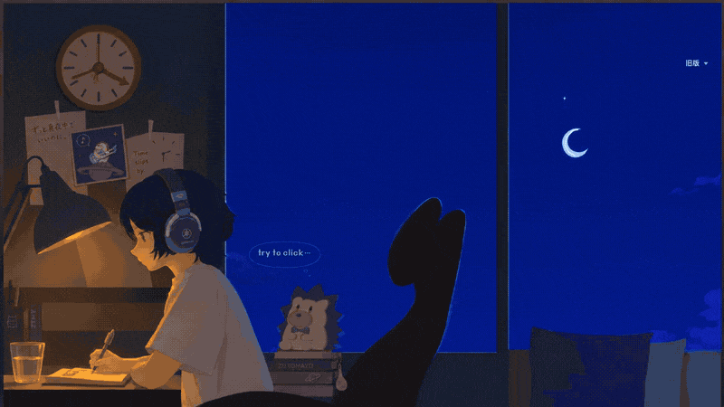
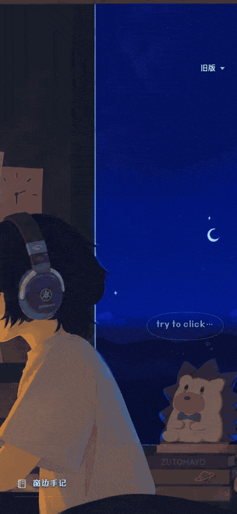

# Starfield · 星空博客主题

**从窗边出发，在一片星空里寻找文章。**

Starfield 是一个为 Hexo 设计的插画式博客主题。每篇文章都是一颗星：穿过房间的窗户，在夜空中探索、观察日期，再展开正文阅读。它保留 Markdown 写作和静态站点的简单方式，也为文章之间的联系、日常手记与友链留出了属于自己的空间。

体验效果：
[作者博客 · Stargazer’s LucidDream](https://blog.stargazer-luciddream.top/)


这个主题博客的设计思路和灵感来源：
[设计思路与灵感](https://blog.stargazer-luciddream.top/2026/10/24/%E8%AE%BE%E8%AE%A1%E6%80%9D%E8%B7%AF%E4%B8%8E%E7%81%B5%E6%84%9F/)

### 电脑端



[观看电脑端视频](docs/starfield-desktop.mp4)

### 手机端



[观看手机端视频](docs/starfield-mobile.mp4)

*演示取自作者博客的本地预览，以原速连续录制；手机画面使用浏览器模拟竖屏和触摸操作，手记正文使用虚构示例。画面中的站点标识与旧版入口是个人站点的配置，主题默认不包含这些内容。*

## 主题特色

- **窗边与星空**：以手绘房间和夜空作为首页。点击窗口进入星空，拖动或使用键盘探索；星星、云层和场景会随着视角变化。
- **文章成为星星**：点选文章星，先查看日期、星表号和星等，再打开阅读长页。正文带有阅读进度、相邻文章导航和作者设置的相关文章。
- **两种探索方式**：关联模式展示作者指定的文章联系，时间模式按照发表时间串联文章。文章星位与星表号会保存下来，新增文章不会重新打乱已有记录。
- **星图与检索**：通过星盘打开文章索引，按标题、标签、正文或星表号搜索，也可以组合年份和星等筛选。
- **窗边手记**：将简短的日常记录按月份收进手记，与文章分开；支持翻月、独立页面、草稿和按需展开图片。
- **远方的信号**：星空中的通信卫星是友链入口，也可以直接访问友链页面。
- **为不同设备准备**：支持触屏、键盘和减少动态效果；文章、手记和文章清单有可直接访问的静态页面。

主题自带场景与界面素材。站名、作者、Logo、友链、文章和手记由自己的站点提供；空站点会显示空状态。

## 快速体验

需要 Node.js 22 或更新版本，以及 npm。在主题目录运行：

```sh
npm ci
npm start
```

打开 [http://127.0.0.1:4175/](http://127.0.0.1:4175/)。仓库自带一个空白示例站点，初次打开没有文章、手记和友链；可以用下面的命令添加内容：

```sh
npm run new -- post "第一篇文章"
npm run diary -- "一则手记"
```

文章和手记分别位于 `example/source/_posts/` 和 `example/source/_journal/`。示例站点的本地写作内容和星图记录默认被 Git 忽略；长期写作建议建立自己的 Hexo 站点，单独保存内容和配置。

在主题目录执行 `npm run build` 可生成 `example/public/`，用于静态托管；`npm test` 运行主题测试。

## 安装到自己的 Hexo 站点

以下命令在 **Hexo 站点根目录**执行。站点需要 Hexo 8、EJS 和 Markdown 渲染器，以及索引、归档、标签、分类生成器。缺少这些依赖时可以安装：

```sh
npm install 'hexo@^8' 'hexo-renderer-ejs@^2' 'hexo-renderer-marked@^7' \
  'hexo-generator-index@^4' 'hexo-generator-archive@^2' \
  'hexo-generator-tag@^2' 'hexo-generator-category@^2' 'hexo-server@^3'
```

把主题分支克隆到 `themes/starfield/`，并安装主题自己的运行依赖：

```sh
git clone --single-branch --branch codex/starfield-theme \
  https://github.com/roverstargazer1-max/Stargazer-Lucid-Dream.git themes/starfield
npm --prefix themes/starfield ci --omit=dev
```

在站点根目录的 `_config.yml` 中启用主题，并填写自己的站点信息：

```yaml
title: 我的星空
author: 你的名字
url: https://example.com
theme: starfield
```

然后使用熟悉的 Hexo 命令：

```sh
npx hexo new post "第一篇文章"
npx hexo server
# 或生成静态站点
npx hexo generate
```

`hexo server` 用于本地预览，`hexo generate` 的输出位于站点的 `public/`。如果网站部署在子目录，例如 `https://example.com/blog/`，将站点 `url` 设为该地址，并设置 `root: /blog/`。主题目录可以改名；对应修改站点的 `theme` 和主题配置文件名即可。

## 写文章，点亮星空

继续在 `source/_posts/` 使用 Markdown 写作即可。也可以把主题的 `scaffolds/post.md` 复制到站点的同名位置，新建文章时会带上可选的星空字段。

首次预览或生成时，主题会为已发布文章准备稳定身份、原链接、摘要和星位，并写入文章头部及站点的 `source/_data/starry-layout.json`。**请把更新后的文章和这份星图记录一起保存、提交到自己的站点仓库**，以便后续构建延续原有星位、星表号和链接。删除文章不会复用它的星表号；草稿不会进入星图。

文章关联和星等均为可选项：

```markdown
---
title: 一篇文章
date: 2026-10-01 20:00:00
tags: [随笔]
related:
  - 另一篇文章的文件名
  - post: 第三篇文章的文件名
    reason: 这两篇文章的联系
star:
  rank: ordinary
  isolated: false
---

在这里写下正文。
```

`related` 引用文章文件名，不含 `.md`；每对文章填写一次，主题会建立双向关联。`rank` 可选 `ordinary`、`important` 或 `treasured`，分别对应星等 4.0、2.5、1.0。`isolated: true` 让文章不参与自动探索路径和时间连线，手动填写的关联仍会保留。`starry_excerpt` 可手写摘要，留空则从正文自动提取。

## 写一则窗边手记

在自己的 Hexo 站点中，主题提供 `journal` 命令：

```sh
npx hexo journal "散步之后"
npx hexo journal --content "今天想留下的几句话。"
npx hexo journal --date "2026-10-01" --draft
```

命令会在 `source/_journal/` 创建 Markdown 文件，不覆盖已有记录；也可以手动创建：

```markdown
---
date: "2026-10-01 21:00"
title: 散步之后
published: true
---

今天的天空很清澈。
```

日期也可以只写 `"2026-10-01"`；`title` 可省略，`published: false` 留作草稿。手记不生成文章星，也不进入文章检索。访客可以在房间或星空中翻开手记，或直接访问 `/journal/`。

## 个性化配置

在站点根目录新建 `_config.starfield.yml`，只需填写想覆盖的选项：

```yaml
featured_article_id: "" # 留空时使用第一篇文章
branding:
  logo: "" # 留空显示站点标题；也可填写图片路径或 URL
friends:
  - name: 朋友的站点
    link: https://example.org
    desc: 一段介绍
    avatar: "" # 可选，填写图片路径或 URL
scene:
  motion: full # full 或 soft；同时尊重系统的减少动态效果设置
  passage_blur: false
  room: image/starfield/room-poster-detail-v20.webp
  painted_sky: image/starfield/painted-sky-v11.webp
  window_mask: image/starfield/room-window-mask-v17.svg
```

`featured_article_id` 使用生成后文章头部的 `starry_id`。友链配置后会出现在卫星面板和 `/pages/friends/`。房间、天空与窗口遮罩可替换为站点 `source/` 下的素材；房间插画与遮罩的几何位置需要配合。

也可以把主题选项写在站点 `_config.yml` 的 `theme_config` 下。两种方式与优先级见 [Hexo 主题配置说明](https://hexo.io/docs/configuration#Alternate-Theme-Config)。
