# 星空博客开发记录资料集

整理日期：2026-10-11。资料截止于本地 `codex/starfield-personal` 的 `87a0401`。本文用于查找开发过程、原始材料和历史实现，不是待发表的博客文章。

## 使用说明与证据范围

本文按时间整理「提出的要求 → 实际处理方式 → 当时画面 → 后续变化」，并分别标明原型、正式主题、本地验证和未实施设计。文中的“作者要求”来自仓库内已保存的访谈与设计记录；实现方法来自代码、提交和验收记录。没有完整会话导出，不能据 Git 作者名判断每段代码是作者手写还是工具辅助完成，也不能恢复未记录的心理活动、耗时或动机。

图片分三类，图注均标明：**原有验收截图**是本次查阅前已存在的图；**历史代码复现**是 2026-10-11 从指定提交的只读副本重新运行所截；**当前本地截图**是本次对当前生成页面的采集。复现使用 Chromium 149、当前系统字体；两个历史 Hexo 站点复用了当前安装依赖和 Node 25.7.0，因此不等于完整还原当年的运行环境。原型直接运行该提交的原生浏览器代码。手机图是浏览器模拟，不是真机。

本次没有改动博客功能、UI、源文章或星位，没有创建这篇开发博客，也没有部署。原始截图不作拼接或重绘；选中的本地验收图片逐字节复制到本目录，作为可随文档保存的插图，不改变原测试产物的保存规则。

- 按时间阅读：下文。
- 找到具体版本和提交：[版本索引与回看方法](versions.md)。
- 查原文、素材、提示词和图片来源：[资料索引](sources.md)。
- 全部可达提交的作者／提交时间：[commits.tsv](commits.tsv)，共 175 条，包含博客内容和依赖更新，未全部当作改版步骤。
- 截图来源与校验：[原有图片](existing-images.json)、[原型／Kira 复现](reconstruction.json)、[正式主题／当前截图](theme-reconstruction.json)。

## 阶段总览

| 时间 | 已有记录所显示的工作 | 当时的性质 |
| --- | --- | --- |
| 2025-10 至 2026-09 初 | 建立 Hexo／Kira 博客，积累文章，调整背景、透明度、日夜与移动端 | 原博客；首次上线日期不明 |
| 2026-09-08 | 将文章映射为星星，比较 A/B/C；照片天空、程序天空、四种屋顶与小比例前景 | 16 篇虚构文章的原型 |
| 09-09 至 09-10 凌晨 | 静态配色、星光微动、字体与标题、观星者、探索路径和增量生长 | 原型研究 |
| 09-10 | 屋顶改窗边厚涂；半球投影、小星图、银河、山丘与互动云 | V11–V13 原型 |
| 09-11 至 09-13 | 书页显影、环视、连续穿窗、反向返回、缩短等待、入口星尘 | V14–V19 动效迭代 |
| 09-14 至 09-16 | 冻结 V19；V20 可用性优化；房间插画替换、海报细化、物件重绘与回退 | 本地原型；部分视觉被否定 |
| 09-30 至 10-01 上午 | 主题化访谈、整体规则确认、旧版基线、一篇真实正文到全量数据与旧路由 | 正式主题开始建立 |
| 10-01 下午 | 收口为个人站点；按文件名关联，一次预览准备，全量媒体／导航／降级验收 | 本地个人主题实现 |
| 10-02 至 10-03 | 冷色复古阅读窗口、视线聚焦、轻雾显字；B 观测注记 | 正式主题视觉调整 |
| 10-07 至 10-08 | 原素材观测面板、字形和裁片、立体几何、声波、步行重做、宝蓝配色、移除方位入口 | 正式主题多轮修正 |
| 10-08 至 10-10 | 图片／静止绘制、首屏、过场、低功耗绘制预算优化 | 多轮本地性能测量 |
| 10-09 | 蓝色原图文章页、阅读进度人物、Logo2、近距离标题、手机导航与标题排布 | 正式主题视觉更新 |
| 10-10 | 双主题统一输出、切换入口、首屏窗景、视角边界、资料归档 | 本地构建与验证 |
| 记录标注 10-10，提交 10-11 | 新小星图、详细星图、文章检索、底图和搜索图标候选 | 设计与素材，功能未接入 |
| 10-11 | 七项工程／性能整改；新文章带注释模板；README 更新 | 本地提交，未发布 |

## 1. 起点：已有一个持续写作的 Kira 博客

可达 Git 的第一条提交是 `b862ab8`（2025-10-19，`first commit`）。10 月已有背景、命名、字体行距、音乐、友链和导航等修改。2026 年继续添加或修改文章，7–8 月补封面、页脚、背景透明度与日夜外观；8 月还有首屏资源和静态缓存相关提交。`875b072`（2026-09-01）记录了移动端外观与夜间浮动按钮修正。这些说明星空改版建立在已有站点上，没有证据表明从零重写了内容系统。

9 月 8 日的[仓库事实记录](../../design/starry-blog.md#仓库事实2026-09-08)列出 10 篇文章、归档／关于／友链页面、9 位朋友和现有封面。内容包括 Markdown、原生 HTML/style、图片、音乐、置顶和持续积累类文章。没有现成的显式文章关系数据。原博客使用 Hexo 与本地定制 Kira，地址为年月日加文件名；当时只有托管配置，记录未核实实际线上情况。

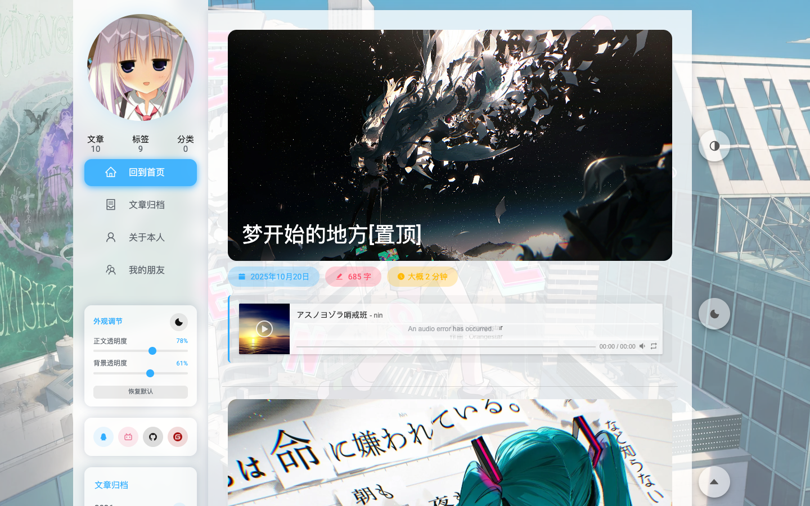

图 1｜**历史代码复现**：`875b072` 的首页。可见左侧资料与导航、透明卡片、封面和播放器。复用了当前依赖，播放器还显示远程音频错误；该图只说明本次复现的外观，不证明 9 月 1 日音频状态，也不是当年的线上截图。2025 年最初站点的逐次原始截图未找到。

## 2. 想法与约束：文章成为可以探索的星星

最早保存的设计整理围绕个人表达与趣味：全站处在同一片星空，文章是可接近的星，距离改变信息量，内容关系可以被发现。早期场景从深夜屋顶开始，生活物件只占少量空间；读者控制观察视角，不控制人物走动。

记录中逐步明确了操作：先点星选中并靠近，到位后再点同星阅读；阅读层关闭后恢复视角和选中项；已读、镜头和停靠历史在当次访问内保留；时间模式与关联模式分开。内容关系由作者采用，空间邻近线路不自动成为文章语义关系；没有理由就不编理由。旧星位需保存，新文章加入时不全局重排；已有文章地址需继续可读。

作者继续本地写 Markdown，没有要求搭建后台、账户或跨设备状态服务。AI 辅助提出关系只是可选写作方式，记录不证明上线了自动推荐或在线 AI 服务。设计列有 100,000 Stars、Outer Wilds、NASA Eyes 与数字花园作为启发，不能由这些参考推定照搬了实现或达到了它们的体验。

来源：[设计第 1–7 节和访谈索引](../../design/starry-blog.md)。该文件现存首次入 Git 是 09-30 的 `41b60e4`；其中保存的是更早的访谈整理。**第一次产生想法的精确日期、完整原话和更早草图未找到**。R1–R6 到 09-30 才有整体确认记录，不能把 09-08 的原型反馈当作整体批准。

## 3. 09-08：先比较结构，再逐步调整天空与屋顶

### 初始 A/B/C

`940503f`（09-08 13:31）建立了 16 篇 mock 文章、相同空间数据下的三种阅读结构：A 屋顶入梦、B 观测手记、C 漂浮书页。用原生 Canvas 投影与 DOM 点选／阅读层验证相机推进、两次点星、读完关联和返回。它没有读取真实文章，也没有形成正式主题。

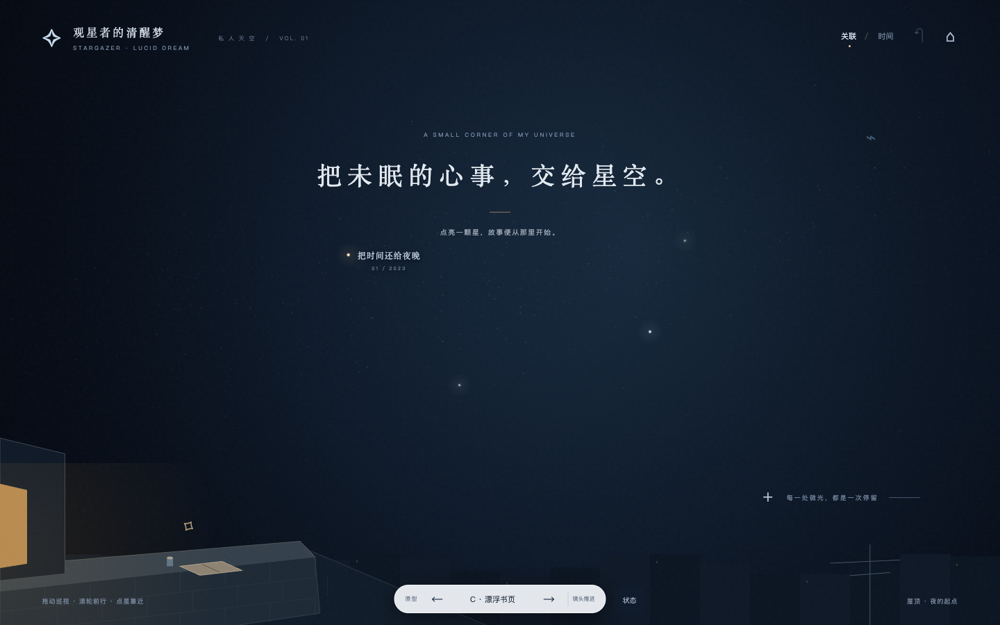

图 2｜**历史代码复现**：`940503f`，C。屋顶是程序画出的几何前景，天空仍有大段开场文字。另见同提交的 [A](images/v01-1.png)、[B](images/v01-2.png)及[模拟正文](images/v01-reader.png)。A/B 是并行方案，不是先后上线的版本。

### V2：写实素材与快速靠近

作者认可交互并偏好 C，要求文章更分散、镜头有可见的快速推进。`6586a83` 用参考天空照片和写实屋顶，靠近约 1.05 秒，也保留约 220ms 的轻过渡。后续反馈认为直接铺照片生硬，亮星压过文章入口，因此这一方案没有继续成为天空基线。

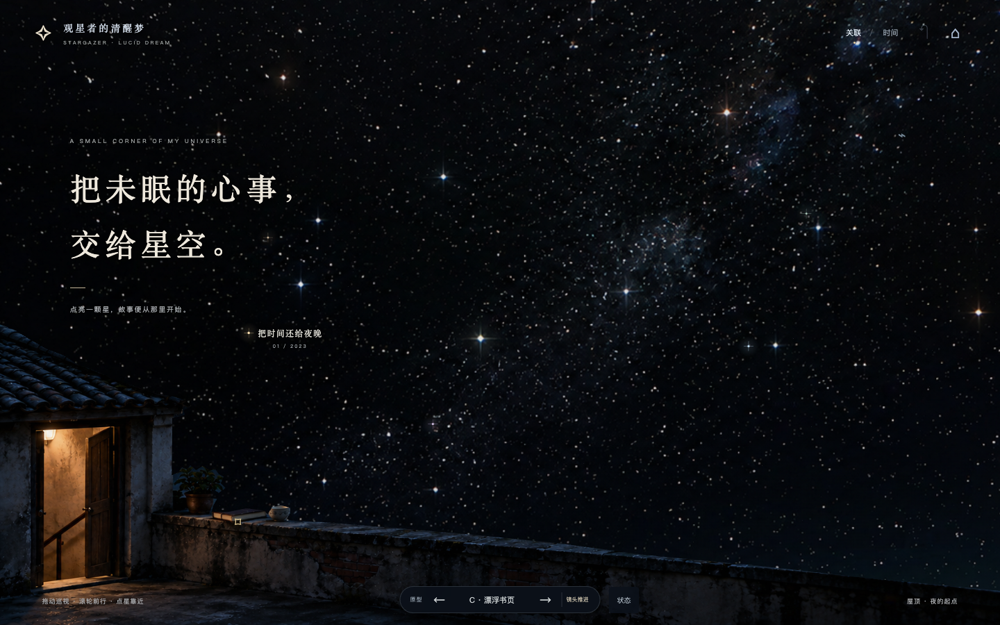

图 3｜**历史代码复现**：`6586a83`。图中密集摄影亮星与文章光点共存，左下是写实屋顶。素材和提示词见[美术方向](../../../themes/hexo-theme-kira/prototypes/starfield/ART-DIRECTION.md)。

### V3：程序星空与前景边缘修正

`052d5ed` 将照片天空换成程序远星、银河尘带及与相机共用朝向的空间投影；文章星独立绘制，具有固定个体差异，减少被背景淹没的问题。照片仍保留作参考。紧随的 `bc6a04f` 将屋顶固定在画面底沿，转离时淡出，避免拖动露出裁边。这是 2.5D 前景处理，不能写成完整三维屋顶。

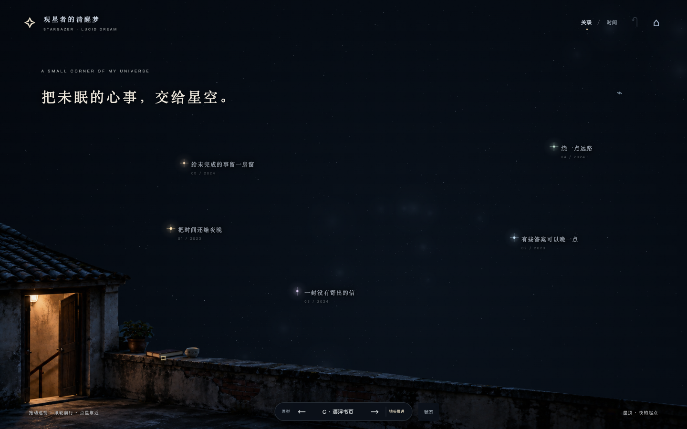

图 4｜**历史代码复现**：`052d5ed`。天空开始以稀疏光点承载文章，写实屋顶暂保留。

### V4/V5：四种屋顶、删文案、缩小前景

`a7e9ad7` 只对屋顶比较二次元、极简色块、纸雕绘本、像素四种风格，天空与交互共用；删除开场装饰文案。作者选择二次元后，`6f697a9` 把前景缩小，桌面高度约 30%，文章向右侧、右上和纵深分散，首屏约三颗，不以强行截断星数实现稀疏。此时使用的是固定 mock 布局，真实文章自动布局尚未完成。

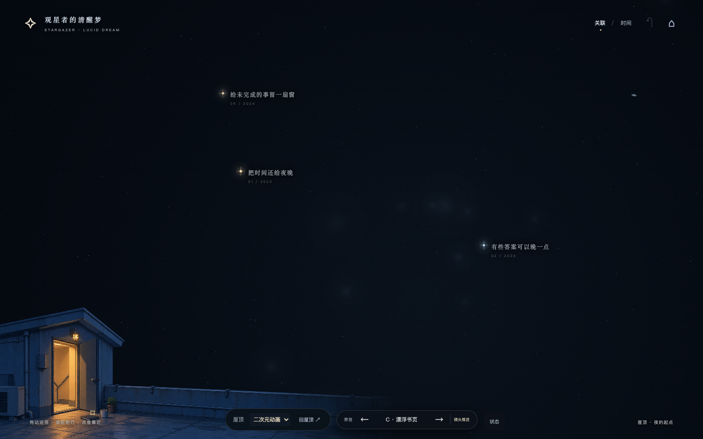

图 5｜**历史代码复现**：`6f697a9`。另见 V4 的[二次元](images/v04-1.png)与[纸雕](images/v04-2.png)复现。四种素材与完整提示词见[屋顶风格记录](../../../themes/hexo-theme-kira/prototypes/starfield/ROOF-STYLES.md)。

## 4. 09-09 至 09-10 凌晨：配色、微动、字标、人物与生长

这一组旧 README 用“第几轮试验”命名，本文沿用原名，不补造 V6–V10 的发布标签。

| 记录与提交 | 做了什么、怎样做 | 后续或限制 |
| --- | --- | --- |
| [静态美术第一轮](../../../themes/hexo-theme-kira/prototypes/starfield/ART-STUDY-01.md)，`db10650` | 比较墨蓝冷夜与烟褐旧梦；按文章 ID 固定星体大小、光核、散射与少量双星／星芒；加静态样本板 | 两种配色当时待比较，不是两次发布；不是天文光学仿真 |
| [第二轮微动](../../../themes/hexo-theme-kira/prototypes/starfield/ART-STUDY-02.md)，`e04717e` | 叠加独立平滑噪声，约 ±3.6% 文章星亮度；云、远星、近星和文章星分层鼠标视差；悬停／拖动／推进时冻结偏移 | 微动不移动真实坐标；阅读、弹层、隐藏页面暂停；不能据参数证明流畅 |
| [第三轮字标与排版](../../../themes/hexo-theme-kira/prototypes/starfield/ART-STUDY-03.md)，`5fcbf3d` | 两行衬线英文字标；减少日期／序号常显；缩窄预览；试验悬停、聚焦和选中时显题 | 当时使用系统字体，跨设备字形可能不同；后来换为作者原 PNG Logo2 |
| [第四轮白灰文字与观星者](../../../themes/hexo-theme-kira/prototypes/starfield/ART-STUDY-04.md)，`aeca90d` | 去棕黄文字，比较素白／雾灰／冷白；用内置 image_gen 编辑屋顶观星者；Canvas 按轮廓裁切 | 生图把棋盘画进 RGB，未得到真正 alpha；网页用裁切规避，不宜把该素材叫透明 PNG |
| [探索路径研究](../../../themes/hexo-theme-kira/prototypes/starfield/EXPLORATION-PATHS.md)，`d245a04` | 稀疏空间路径、普通／重要／珍藏星等、孤立星与有约束随机增量生长；可试加、找新星、导出布局 | 新增 mock 只在内存，刷新恢复；不是后来随仓库保存的真实星位流程 |

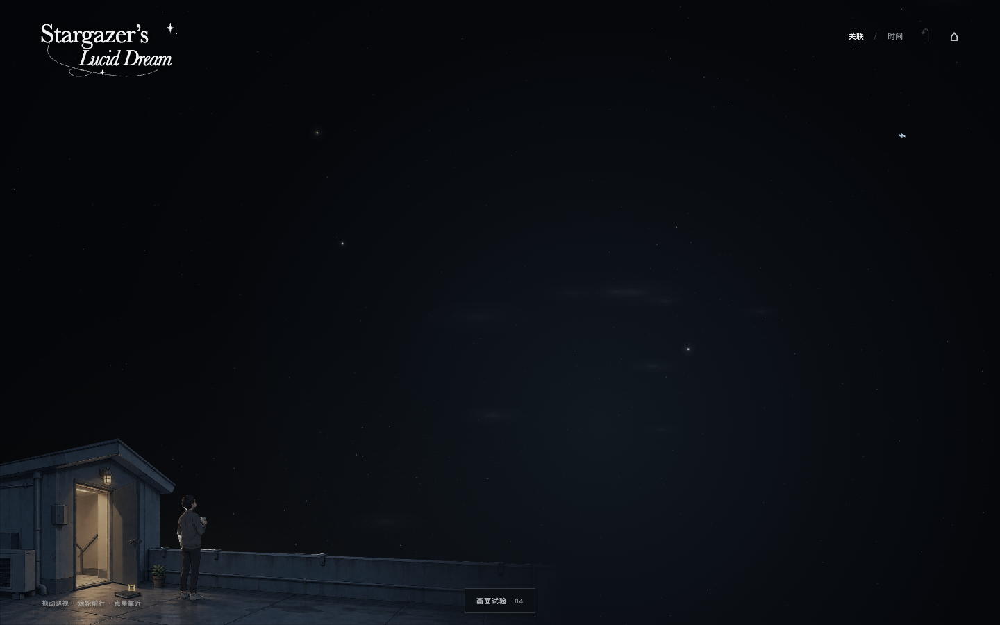

图 6｜**历史代码复现**：`aeca90d`。人物站在小比例屋顶内，左上换为英文衬线字标；标题按需隐藏。第一轮两种静态配色另见[墨蓝](images/v06-1.png)、[烟褐](images/v06-2.png)，文件中的 v06/v09 仅为本资料排序名称。

## 5. 09-10：V11–V13 从屋顶转向窗边与半球穹顶

### V11：动画厚涂，窗边作为入口

作者认为方向仍过于写实，提供厚涂参考。`f4ab4bd` 改成暖灯书桌与窗边：桌面直接使用作者图，手机生成独立竖版，窗外厚涂云景另由 image_gen 生成。点窗口用约 2.2 秒缩放与溶解进入星空，天空星芒、预览和纸面跟随配色；手记与原有小交互沿用。

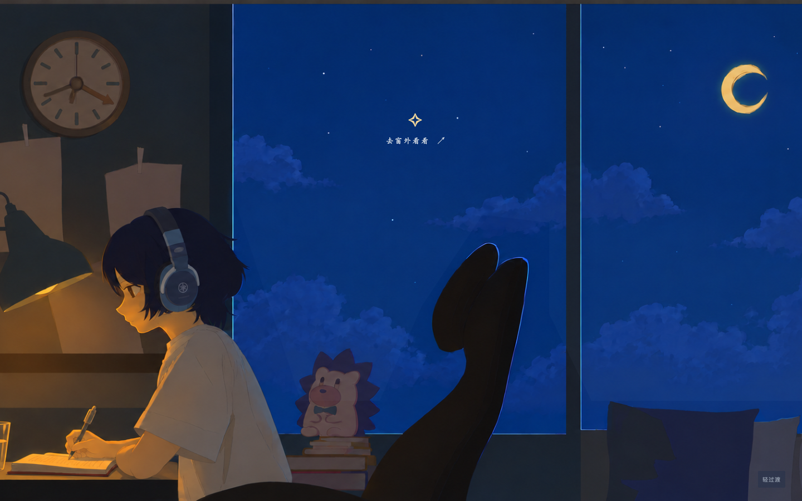

图 7｜**历史代码复现**：`f4ab4bd`。仍有“去窗外看看”文字引导。此时入口是图片过渡，人物没有独立骨骼动画，不能写成完全三维房间。见[天空复现](images/v11-sky.png)和[V11 记录](../../../themes/hexo-theme-kira/prototypes/starfield/ART-STUDY-06.md)。该记录的两段完整提示词实际为 `undefined`，这一项资料有缺失。

### V12：天空对象共用半球投影

作者要求能水平转圈、抬头到天顶，文章布局在穹顶上。`e71f8a6` 将文章、云、月亮和天空改成共同投影，允许 0–90° 仰角；拖动显露小星图，静止约三秒淡出，点击地图转向；云柔和遮挡后面的星光与线。之后 `4f31b68`、`0e89413`、`dfbcd61` 调整地图与控件融入度及移动中的线条淡出；`e451e2b` 补天顶银河，`4541f5e` 扩大视野并增加方向恢复。

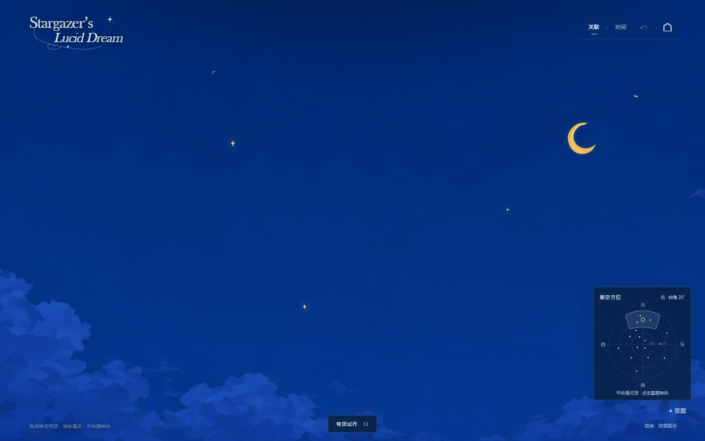

图 8｜**原有验收截图**，来自 sky-studies。具体几何、跨 360° 连续性与操作记录见[V12 说明](../../../themes/hexo-theme-kira/prototypes/starfield/DOME-STUDY-12.md)。该图展示半球阶段，不证明当时的真机手势或帧率。

### V13：山丘、雾与可轻触的云

`1612293` 保存大气方案，`d6d6a1c` 实现低空／天顶统一深蓝、远山薄雾和三点暖灯，三朵独立云短点按后散开，约七秒恢复；拖动和双指缩放仍控制天空。

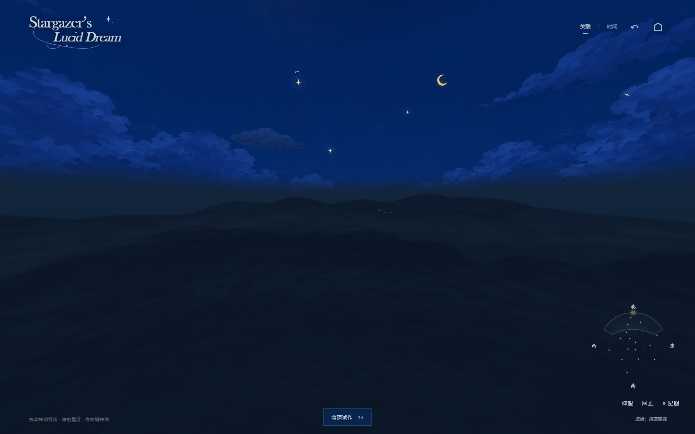

图 9｜**原有验收截图**。当时山丘可以进入画面较大区域；10 月 10 日又按作者要求设置“最多约五分之一”的下边界。实现与其他天空截图见[V13 记录](../../../themes/hexo-theme-kira/prototypes/starfield/ATMOSPHERE-STUDY-13.md)和[sky-studies](../../../.scratch/starry-blog/archive/prototypes/sky-studies/README.md)。

## 6. 09-11 至 09-13：V14–V19 动效反复调整

V14 的记录明确日期为 09-11，V15–V19 主迭代为 09-12，V19 后续引导和地图调整在 09-13。它们仍使用 16 篇虚构文章。下表时长是对应阶段设定或记录值，不能当成当前主题参数或实际帧率。

| 阶段 | 作者反馈／方向 | 实现方式与结果 | 原记录 |
| --- | --- | --- | --- |
| V14 星光书页 | 借参考中的连续动作与文字显露关系 | `motion.js`／`motion.css` 分离时间线；由星点牵出纸页，按真实 DOM 行框建遮罩；同一轴反向收回。进场 2.1s、点星 1.46s、开页 1.46s、收页 0.82s | [V14](../../../themes/hexo-theme-kira/prototypes/starfield/MOTION-STUDY-14.md) |
| V15 环星书卷 | 穿窗后慢慢环视，再让星点亮起；简介像书卷展开，遮块先停留 | 穿窗 2.1s、360° 环视 16s、停稳 0.9s、亮起 3.2s，总计约 22.2s；简介约 5.6s。可跳过 | [V15](../../../themes/hexo-theme-kira/prototypes/starfield/MOTION-STUDY-15.md) |
| V16 无框显影 | 否定上下卷柄的具象书卷；缩短等待并承接惯性 | 删除卷柄、硬边框和矩形底，改夜色渐隐；白块停留 1.7→1.1s；环视 16→12s，提前与穿窗重叠，总进场约 16.8s | [V16](../../../themes/hexo-theme-kira/prototypes/starfield/MOTION-STUDY-16.md) |
| V17 连续穿窗 | 窗内与探索是同一片实时天空；加入侧移转向，加快显字 | 图片前景配 SVG 窗口遮罩，实时穹顶透出；共享起始时间。穿窗 1.9s、环视 7.8s，总约 11.9s；显影 2.4→1.6s | [V17](../../../themes/hexo-theme-kira/prototypes/starfield/MOTION-STUDY-17.md) |
| V18 轻快返回 | 等待缩短三分之二、显影减半、去斜线、反向回屋 | 停稳＋亮起 4.1→约 1.37s，总进场约 9.17s；显影 1.6→0.8s；从当前实际相机回屋约 2.6s | [V18](../../../themes/hexo-theme-kira/prototypes/starfield/MOTION-STUDY-18.md) |
| V19 穿窗入星 | 取消完整一圈，保留穿窗旋转 | 约 60° 连续转向与侧移，总进场约 2.5s；星光在减速时同步清晰，落位可探索；反向回屋约 2.6s | [V19](../../../themes/hexo-theme-kira/prototypes/starfield/MOTION-STUDY-19.md) |
| V19 后续 | 白块等待至少减半；去突兀入口文字；手机地图过大 | 白块停留 1.1→0.5s，简介总约 2.8s；入口换星尘、悬停／聚焦微光；小屏地图 142→96–116px | [后续反馈汇总](../../design/starry-blog.md#11-完成与复核状态) |

V14 借鉴资料包括 RhineLabUI 和作者提供的十秒录屏，保留的是阶段连续、文字显露与反向归位关系。该记录明确没有引入参考的模型、字体、音效或品牌素材。[参考截图](../../../.scratch/starry-blog/archive/prototypes/sky-studies/rhine-video-timeline-v14.jpg)属于别人的界面，不是本博客效果；完整原录屏未在本仓库材料中找到。

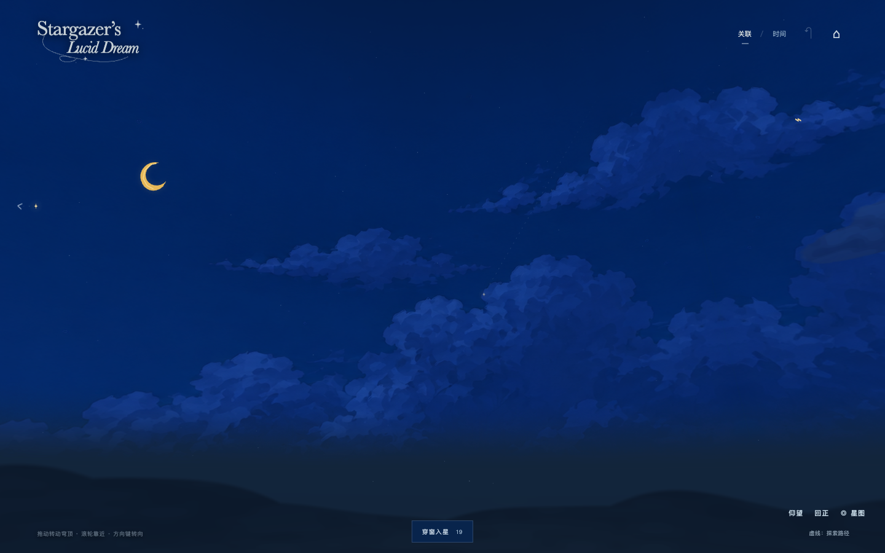

图 10｜**历史代码复现**：从 `41b60e4` 中的 46 文件冻结 V19 副本运行，显示调整后的穿窗终点。V14–V18 没有逐版独立提交和冻结副本，不能补造各版画面；图 10 仅展示 V19，不代替中间版本。

现有证据表明 V14–V20 文档与累计代码在 09-30 的 `41b60e4` 一起进入可达 Git。该提交还保存了当时未提交状态清单。目录 `baseline-v19-20260914` 的日期是冻结记录命名，不是该快照首次进入 Git 的日期。回看方法见[版本索引](versions.md)。

## 7. 09-14 至 09-16：V20 操作优化与美术替换

### 从冻结 V19 开始整理可用性

09-14 的[优化计划](../../../.scratch/starry-blog/archive/prototypes/v20/optimization-plan-v19.md)提出简介裁切、滚动区、热区、小字和构图问题。09-15 的[V20 验收](../../../.scratch/starry-blog/archive/prototypes/v20/optimization-v20-acceptance.md)记录了固定头部、单一滚动正文、固定阅读动作；常用 44px 热区；横屏右侧简介与紧凑屏星图暂收简介；文字大小、间距、对比度；停靠视野约放宽 6%；同篇简介首次约 2.8s，完整显露过后复访约 0.7s，复访与“读完”分别判断。

也做了光核约 +10% 增益、远云灰度和精简字标对照。光核调整被保留，云色和字标的候选没有被选用。九种视口、200% 文字与原生页面缩放都有单独记录；这属于本地原型检查，没有接入正式文章。

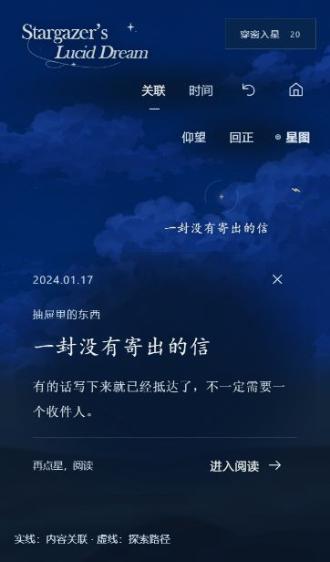

图 11｜**原有验收截图**：V20 的虚构文章《一封没有寄出的信》。保留固定头部、简介与阅读动作。不是作者真实文章。

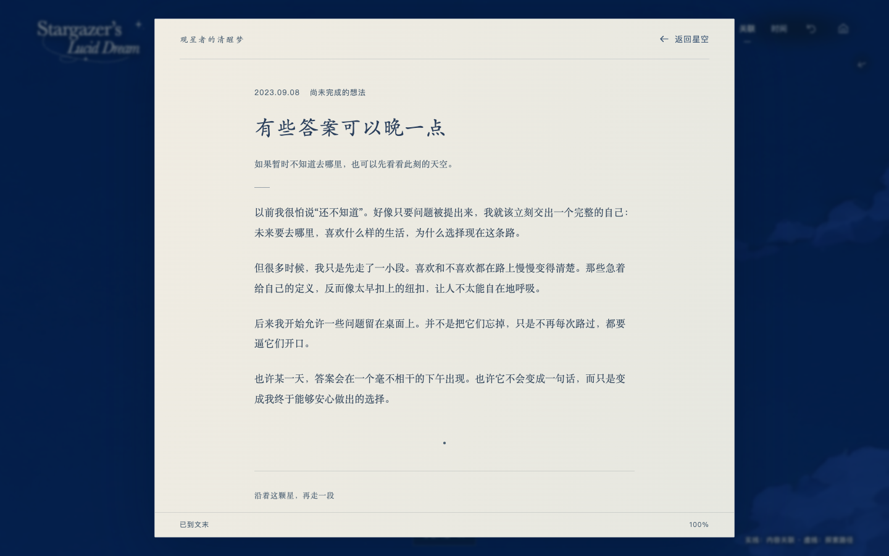

图 12｜**历史代码复现**：`41b60e4` 内的 V20 原型，虚构文章暖色纸面正文。与后续复古窗口和蓝色原图文章页可对照。

V20 测量多次出现约一秒一次的动画回调，页面虽报告 visible，仍无法排除宿主调度干扰；Edge 对照条件也不一致。因此原记录没有证明性能提升、稳定 60fps 或真机顺滑，本文保留这一限制。

### 桌面插画：作者提供图 → 海报细化 → ZTMY 重绘 → 回退

| 日期 | 材料与处理 | 结果 |
| --- | --- | --- |
| 09-15 | 作者新提供带海报、挂件和书本的图，原样复制为 `room-personal-v20.png`，沿用构图与窗口遮罩 | 桌面原型换图；手机暂沿用 V11 竖版。见[替换记录](../../../.scratch/starry-blog/archive/artwork/room-artwork-update-20260915.md) |
| 09-15 | 按刺猬、双颈吉他、带环行星参考，内置 image_gen 细化墙上小海报 | 生成 `room-poster-detail-v20.png`，后来作为桌面入口基底。见[海报记录与参考](../../../.scratch/starry-blog/archive/artwork/poster-redraw-20260915.md) |
| 09-16 | 重绘耳机、小猫眉毛与字样，调整摆件窗口遮罩 | 生成 `room-ztmy-detail-v20.png`；提示词请求 4K，实际 1672×941，不应称 4K。见[重绘记录与完整提示词](../../../.scratch/starry-blog/archive/artwork/ztmy-detail-20260916.md) |
| 09-16 后续 | 作者体验后要求恢复上一版 | 入口回到海报细化图与原遮罩；重绘图保留作历史资料，不是当前入口 |

原图对照：[作者替换图](../../../themes/hexo-theme-kira/prototypes/starfield/assets/room-personal-v20.png)、[采用的海报细化图](../../../themes/hexo-theme-kira/prototypes/starfield/assets/room-poster-detail-v20.png)、[回退的 ZTMY 重绘图](../../../themes/hexo-theme-kira/prototypes/starfield/assets/room-ztmy-detail-v20.png)。它们是美术素材，不包含页面控件、实时天空或动画。下面当前窗边截图可见最终采用素材的网页合成效果。

## 8. 09-30 至 10-01：把原型接到真实内容

### 主题化访谈与最初实现

09-30 的[主题化访谈](../../../.scratch/starry-blog/archive/planning/theme-discovery.md)当时面向未来可复制模板：保留 Hexo、先个人站验证再准备公开模板、旧版可切回；静态正文和原地址需要有效，关系默认双向。作者当日确认 Q17/Q18，R1–R6 整体规则据此收口。模板计划中的通用默认内容、美术与本地场景校准，是当时的范围，后来个人计划没有全部承接。

实际提交分步建立内容链路：

| 提交 | 实际处理 | 证据 |
| --- | --- | --- |
| `41b60e4`，09-30 21:06 | 保留 Kira 配置／依赖恢复基线，保存 V19、V20 与当时工作区材料 | [旧版恢复验收](../../../.scratch/starry-blog/evidence/02-legacy-build.md) |
| `2995e37`，21:46 | 独立 `stargazer-starfield` 主题；《梦开始的地方[置顶]》先跑通星空→真实正文→关闭／原地址直达 | [一篇文章验收](../../../.scratch/starry-blog/evidence/03-first-real-article.md) |
| `7275831`，23:07 | 10 篇文章准备稳定身份、最初地址与保存星位；缺省摘要从正文生成；重复准备不移动旧星 | [稳定发布验收](../../../.scratch/starry-blog/evidence/04-stable-article-publication.md) |
| `8d0a4d6`，10-01 00:04 | 接入现有图片、HTML/style 与音乐，不把正文缩成 mock 段落 | [媒体兼容](../../../.scratch/starry-blog/evidence/05-real-content-media-compatibility.md) |
| `cea57be`，00:55 | 作者采用关系进入索引，单条展开双向；失效目标提示，候选不向读者输出 | [关系验收](../../../.scratch/starry-blog/evidence/06-bidirectional-relations.md) |
| `356b4f6`，01:58 | 双模式、同篇身份、当前访问停靠／阅读历史与返回 | [模式与历史](../../../.scratch/starry-blog/evidence/07-modes-history-interruption.md) |
| `ff84651`，11:57 | 原归档／年月／标签等集合入口继续指向对应内容 | [旧集合路由](../../../.scratch/starry-blog/evidence/08-archives-legacy-collections.md) |

第一篇读文的原地址包含中文与方括号，记录验证了编码路径、刷新和静态正文。初始化失败、主脚本失败等故障回退先从一篇验证。10 篇全量数据的准备保留原正文，只加发布元数据。关系演示使用临时夹具，验证后恢复为空，没有代表作者采用虚构关系。

### 10-01 下午：范围收口为个人博客

[个人访谈](../../../.scratch/starry-blog/theme-planning.md)与[正式化计划](../../../.scratch/starry-blog/theme-production-plan.md)明确以 V20 为基线，先服务本人的全部真实文章；公开发行、后台、在线 AI、场景校准工具和额外规模实验不进入本次首版。`a6a6c10` 保存范围，`ba8aa2c` 将预览与准备合成一次操作，关系改成文章 Front-matter 中按文件名引用，理由可选；`b6aa7b3` 对齐真实 V20 房间图、探索控件和低性能背景预算；`88a2004` 承接旧页面和静态发布。

随后 `8f12544`、`670fa24`、`5b81bfd` 修正访问状态、键盘／动效及滚轮方向。复核记录中有文末关系重载、旧样式条件、孤立星时间连线、方向键和简介滚动等问题，修复后本地闭环验收完成。初始化图片失败时等待不结束的问题也得到修正。实现记录明确当时不 push，默认生产仍是 Kira；这一配置直到 10-10 才改。

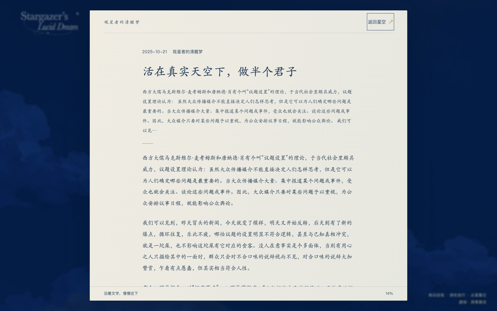

图 13｜**历史代码复现**：`670fa24`，真实《活在真实天空下，做半个君子》。仍是暖色纸面与摘要，已经不是 mock 内容；[关闭后的星空](images/formal-20261001-selected.png)。复用了当前依赖，不能当作当年截图。

来源：[实施记录](../../../.scratch/starry-blog/implementation-progress.md)。当轮最后是 10 项检查及 85 文件新版输出，后来测试数量和文件量继续增长；不把旧数字当作当前状态。

## 9. 10-02 至 10-03：冷色阅读窗口与观测注记

10-02 先有独立冷色阅读试稿，作者随后确认冷色 Windows 95/98 边框、暗底微纹理、窄底栏、X 关闭、B「视线聚焦」开合，点星后去长摘要，采用方案 1「轻雾显字」。`175eeb6` 保存独立试稿，`c94aa34`、`934ab45` 正式整合；`2b425bb` 修正标题与星点热区。它们替换了 V20 暖纸、斜向开合和白块显影，天空与主要操作继续沿用。

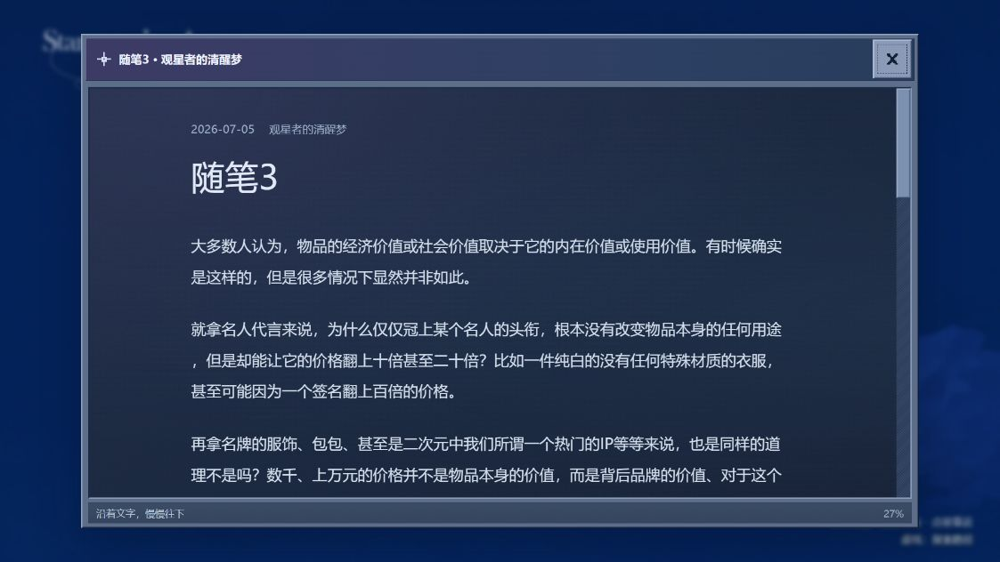

图 14｜**原有验收截图**：灰蓝框、X、窄底栏与真实正文。来源[阅读落地](../../../.scratch/starry-blog/archive/implementation/reader-rollout-20261002.md)。独立试稿[仍保留](../../../.scratch/starry-blog/archive/prototypes/cold-reading-20261002/README.md)，它与正式整合结果应分别查阅。

10-03 的 `a8dcc14` 将作者选定的 B「观测注记」用于正式主题：右侧收窄、冷蓝菱形与竖线、日期及阅读动作，移除冗余序号和控件后的黑雾，保留显字与阅读开合。桌面约 290–350px、窄屏最大 290px，标题变小。19 项检查及真实桌面／窄屏交互有记录。

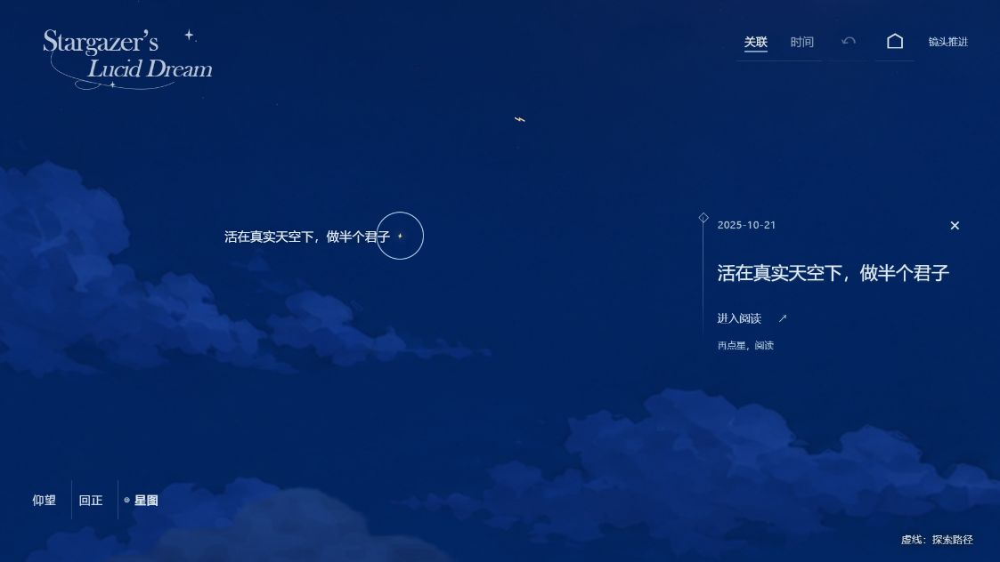

图 15｜**原有验收截图**：真实文章选中后的右侧注记。来源[观测注记落地](../../../.scratch/starry-blog/archive/implementation/sky-ui-rollout-20261003.md)。记录引用独立试稿分支与 `42b9ff7`，当前本地 Git 对象与分支中未找到它；正式采用提交 `a8dcc14` 仍可查。

## 10. 10-07 至 10-08：作者原素材观测面板与动效修正

10-07 作者提供三张 UI 原型和 `assets/` 工程素材。`9b9dad5`／`e3a52b1` 将人物剪影、声波、波浪纹理、年份、月日、READ 和右下几何放入观测面板。年份以真实文章发布年为中心显示前后两年，中央显示两位年；月日取博客时区日期。文章标题只在星旁出现，读到末尾后当次访问变灰，面板不再重复可见标题和关系文字；正文内的关联继续保留。

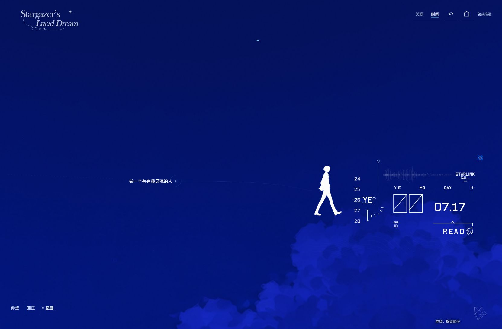

图 16｜**原有验收截图**：初始面板。作者之后指出小图形不准确，此图不能代表全部细调后的最终素材。来源[首次面板落地](../../../.scratch/starry-blog/archive/implementation/observation-ui-rollout-20261007.md)。

作者明确要求直接使用或裁切补充 PNG，不自行绘制 SVG。`745ded4` 保存八个裁片和坐标，`1e2e588` 将原 CSS 装饰替换为裁片，技术字母／数字改用 36 个原透明 PNG。`a561846`、`b8c7b91`、`1043bb5` 调整波纹强度／位置、年份框内留白、STARLINK/CALL、括号刻度和 READ 热区；READ 到位前仍禁止打开，到位后使用手型与原白色素材。

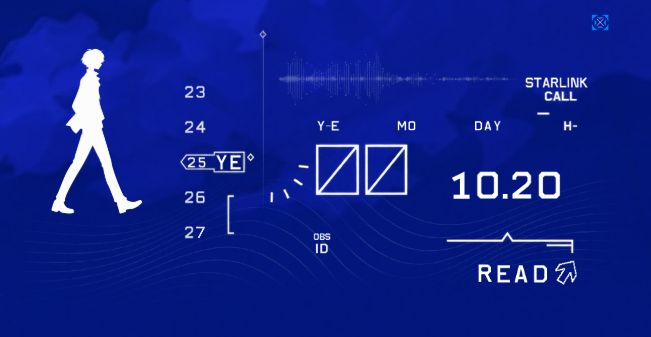

图 17｜**原有验收局部截图**，用于看图 16 之后的形状与排布修正，不是完整页面。来源[补充图形与细调](../../../.scratch/starry-blog/archive/implementation/supplement-ui-rollout-20261007.md)。

后续动画不是一次完成：

| 对象 | 实现与反馈链 | 保留的查阅资料 |
| --- | --- | --- |
| 立体几何 | 最初整图旋转；作者指出有中心轴。`eeed732` 改 PNG 面片立体投影；再按竖直轴参考，`595f4fd` 修正顶点与远近透视，以原图干净线段逐棱连接，后棱较淡 | [中心轴过程](../../../.scratch/starry-blog/archive/implementation/supplement-ui-rollout-20261007.md#几何图形中心轴)、[透视校正](../../../.scratch/starry-blog/archive/implementation/polyhedron-perspective-20261008.md) |
| STARLINK CALL 声波 | `37dba03` 用原图窄条绕中线错峰起伏；作者要求更强对比后扩大到约 5%–140% 高度，高峰更亮，低谷更细淡；隐藏／阅读暂停，减少动态静图 | [声波记录与动图](../../../.scratch/starry-blog/archive/implementation/starlink-call-20261008.md) |
| 人物步行首版 | 原剪影骨骼／网格变形，代码数值检查通过；作者否定人体结构和姿势 | [已否定首版](../../../.scratch/starry-blog/archive/implementation/silhouette-walk-20261008.md)，不能用测试通过替代审美认可 |
| 参考视频重做 | 提取作者录屏中 17 个完整姿势，消除横向前进；作者仍认为关键帧跳切有停顿 | [重做与裁片](../../../.scratch/starry-blog/archive/implementation/silhouette-walk-redo-20261008.md) |
| 补帧、轮廓连续 | 按髋／膝／踝和腿长约束补连续路径，预缓存每轮 68 姿势；作者指出腰部断层后，`27ca3be` 改完整轮廓统一处理 | [补帧](../../../.scratch/starry-blog/archive/implementation/silhouette-walk-smooth-20261008.md)、[轮廓修复及录像](../../../.scratch/starry-blog/archive/implementation/silhouette-walk-edge-20261008.md) |

本机记录约 60 次刷新播放不能推广到所有设备；部分记录明写最终视觉待作者验收。原参考完整录屏未在仓库找到，但提取帧和实际页面预览仍在本机证据目录。

## 11. 10-07/08：宝蓝配色、控件收减与首次性能整理

配色记录标注 10-07，落地在 10-08 的 `91914d1`：天空／银河／远景统一偏宝蓝与深海军蓝，月亮、文章星与高光改冰蓝／青色。文章复古窗口也从灰蓝改饱和蓝；该轮主要修改颜色，不能描述成重做了布局。

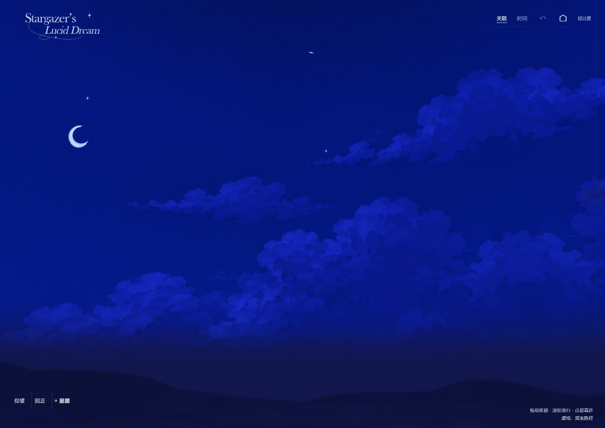

图 18｜**原有验收截图**，来自[配色记录](../../../.scratch/starry-blog/evidence/palette-20261007/README.md)。

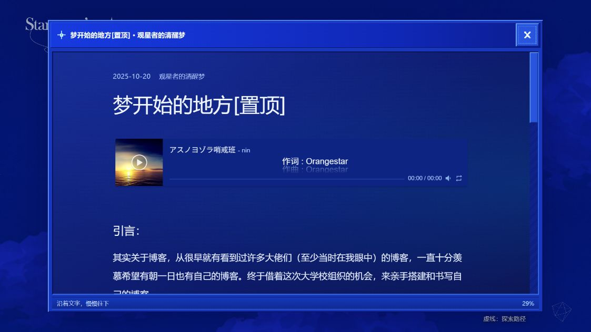

图 19｜**原有验收截图**，来自[文章窗口配色](../../../.scratch/starry-blog/evidence/reader-palette-20261008/README.md)。这是蓝色原图文章页之前的过渡阶段。

`3b863a2` 按作者要求暂时移除“仰望／回正／星图”，包括小图与专属交互；`315842c` 把观测面板整体下移；`df503b3` 改默认完整动效并移除动效切换控件。之后的搜索设计重新提出小星图，属于新的设计更新，并不证明该功能已经恢复。来源：[移除方位入口](../../../.scratch/starry-blog/archive/implementation/remove-sky-controls-20261008.md)、[面板下移](../../../.scratch/starry-blog/archive/implementation/observation-panel-lower-20261008.md)、[默认动效](../../../.scratch/starry-blog/archive/implementation/default-motion-20261008.md)。

10-08 的 `497e847`、`356f325` 是首轮不改呈现的性能整理：静止房间／阅读复用已画背景，进度改由滚动和尺寸变化更新；三张场景图无损 WebP，人物 PNG 清理完全透明区的隐藏 RGB。浏览器解码后四张图 RGBA 零差异。详见下一节各轮性能对照，不能把所有改动合成一个统一基线。

## 12. 10-09：原图文章页、Logo2 与阅读人物

`2a3e947` 按作者“图二”与原工程素材替换复古窗口。原 PNG 叠合出星点、月亮、建筑、流线和蓝色标题装饰，长文底图接续，干净底栏裁片承接实时进度。真实正文独立滚动，长文起点 0%、末尾 100%；图片、字体与播放器造成高度改变会重算。68 帧步行人物随阅读进度沿白轨道移动。生产使用准备好的资源，不要求日常构建运行图像处理工具。

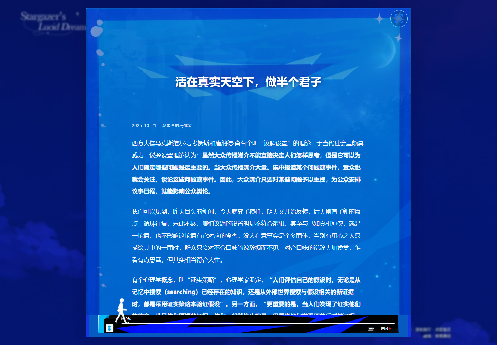

图 20｜**原有验收截图**：标题、日期和进度栏仍是这一轮的初始位置。见[文章页记录](../../../.scratch/starry-blog/evidence/article-page-20261009/README.md)。与末尾当前截图对照，可见后来日期移到了标题下、底栏接缝和人物边距也调整了。

`d45c753` 使用作者原 PNG Logo2、近距离标题和右图标。记录随后把 Logo 放大约 40%，桌面／手机／横屏各适配；星旁标题在鼠标／笔距离约 88px 时显露，移开或拖动后隐藏，键盘聚焦和触屏选中仍可显题。`474c9d4`、`a4a1ffb` 整理手机导航与关联／时间位置，手机模式放左下，返回／回屋在右上。删除画面中的手势说明与线条图例，原操作可访问名称继续保留。

当日进一步按作者反馈逐项修正：

| 提交 | 修正与原因 | 原记录 |
| --- | --- | --- |
| `8d3a99d` | 文章底栏两侧与正文边缘存在突兀接缝，改淡接和边缘对齐 | [接缝](../../../.scratch/starry-blog/evidence/reader-seams-20261009/README.md) |
| `d17a4e1` | 人物终点脚部需留在轨道内，按轮廓与端点留边 | [轨道边缘](../../../.scratch/starry-blog/evidence/reader-walker-edge-20261009/README.md) |
| `de41019` | 静止与滚动时人物换图／大小不一致，统一图集，停下保留最后一帧，继续滚动接着走 | [姿势一致性](../../../.scratch/starry-blog/evidence/reader-pose-consistency-20261009/README.md) |
| `b688870` | 全部文章标题向上移动，桌面约 14px、常见手机约 8px | [标题位置](../../../.scratch/starry-blog/evidence/article-title-lift-20261009/README.md) |
| `e3e72e9` | 日期与署名统一移到主标题下方，随换行保持位置 | [日期署名](../../../.scratch/starry-blog/evidence/article-meta-under-title-20261009/README.md) |
| `bdba181`，10-10 | 主标题试用素材中的 LXGW Marker Gothic，保持正文／日期字体 | [标题字体试用](../../../.scratch/starry-blog/evidence/article-title-font-20261010/README.md) |

来源另见[星空入口整理](../../../.scratch/starry-blog/evidence/sky-ui-20261009/README.md)与[手机导航](../../../.scratch/starry-blog/evidence/mobile-navigation-20261009/README.md)。这些都是本地实现；记录中的“待查看”不改写成已得到最终审美批准。

## 13. 10-08 至 10-11：性能与工程优化的实际依据

几轮分别回答了不同问题，基线、样本和测试条件都不同，不能把下面的百分比连乘或说成一个统一的“总提升”。均为本机 Apple M1／Chromium 的测试；手机使用视口／触控模拟。RAF 间隔是回调调度信号，不是直接屏幕像素帧率；主线程 TaskDuration 占比也不是整机 CPU 或 GPU 使用率。

| 轮次与提交 | 查实的问题和采用处理 | 对照结果 | 不能扩大到的结论 |
| --- | --- | --- | --- |
| [10-08 首轮](../../../.scratch/starry-blog/evidence/performance-20261008/README.md)，`497e847`、`356f325` | 静止正文还重复画 Canvas、写进度；资源可无损压缩。按状态复用帧、事件更新进度、无损图像编码 | 桌面首次资源 4.41→3.06MB；模拟手机 4.39→2.97MB；静止阅读主线程占比 12.84%→4.53%／14.34%→4.65%；单次限速入口 23.14→16.07s | 正常帧节奏前后都约 17–18ms；入口限速不是三轮中位数；有限 JS 堆循环不能证明无限时长无泄漏 |
| [10-09 启动](../../../.scratch/starry-blog/evidence/performance-20261009/README.md)，`81b5773`、`a61ccfa`、`7047cb1` | 房间被完整初始化挡住，先显示回退文字；隐藏界面抢下载；云程序生成集中耗时。先出插图、延后隐藏资源、缓存原云像素与步行 WebP | 三轮中位数，1.6Mbps／150ms／CPU4：插图可显示桌面 19.94→6.58s、模拟手机 19.49→6.12s；超50ms长任务部分累计 639→29ms／605→34ms | 完整星空仍约 19.00／18.54s；Lighthouse 73→86／51→71仅是同条件模拟趋势，FCP未全面改善，Canvas LCP 不稳定 |
| [10-09 专项过场](../../../.scratch/starry-blog/evidence/transitions-20261009/README.md)，`8bc4986`、`afcf0c9`、`e551e93` | 稳态采样漏掉穿窗峰值；根样式变量影响隐藏正文、首次绘制准备不足、房间动画每帧手动同步。缩小变量作用域、预热、原生时间轴播放、过场跳过不可见目标测量 | CPU12三轮：四种进入／返回 P95 约31.6–33.7→17.5–17.6ms；样式与主线程耗时下降；原镜头、关键帧和1900/2600ms沿用 | 12倍限速不等于某款手机；保留了首次83.4ms未通过压力样本，不能保证零掉帧 |
| [10-10 省电](../../../.scratch/starry-blog/evidence/power-transitions-20261010/README.md)，`2eb1dc2`、`31a1154`、`94bb89c` | 主线程较闲仍掉帧；模糊与天空绘制／合成压力。默认关0–1px额外房间模糊，增加实际帧节奏预算、预热／复用缓冲，停稳后才重建主画布 | 真实本机省电、无额外CPU限速、三轮：桌面进入33.4→17.7ms，返回34.5→17.7ms；12段过场通过；32组像素对照相同 | 与其他“不改效果”轮不同，此轮有已记录的模糊默认变化；部分桌面触发 balanced；首次50–67ms峰值未消除；增加缓存有内存成本 |
| [10-11 工程核查](../../../.scratch/starry-blog/evidence/engineering-20261011/README.md)，`3d69a23` 至 `658d3bd` | 先列七项查实问题再逐项整改；重复DOM／投影、云数组、音频生命周期、主题链接、本地服务、输出安装回滚 | 导向2s mutation121→0；云命中数组少1,032,192B；同容器请求／播放器2→1；20次HEAD正文读取49,371,040→0B；安装失败恢复旧输出 | 未复现全站持续严重卡顿；正常P95约17.5–17.7ms，无证据宣称整站帧率大幅上涨；HEAD收益只属于本地服务 |

10-11 的具体工程边界：时间边在索引准备时计算；共用预备穹顶投影器，固定点和月亮路径只建一次；房间控制原样移入独立模块；云命中只保存 alpha，复用不变几何，仍每帧更新悬停／透明度；播放器按容器重用初始化及请求，历史成功换篇前暂停旧音频；自动主题链接只在 URL 变化时刷新，显式刷新处理新 DOM；预览 GET 流式发送、HEAD 只取元信息；构建安装失败可回滚。

该轮逐像素验证有 432 组背景、96 组云；1,182,680 次命中结果一致。原 276 个文件中 269 字节一致，7 个预期 JS 改变、新增两个 JS；63 个 HTML、全部 CSS／图像／字体／文章索引完全相同。68 项测试和双主题构建通过。投影微基准 159.9→64.2ms 只测函数，不是全站耗时。

负面／撤回结果也保留：候选 Logo／人物／几何 WebP 出现边缘像素差异后撤回；10-10 世界纹理预计算未解决主要瓶颈而撤回；10-11 云 style 写入在 Chromium 原本就没有 mutation，未算作布局收益；首轮压力采样与构建重叠失败，后独立重跑，摘要同时保留被排除样本。第三方音频仍未证明成功播放，受控本地静音 WAV 的播放器测试不代替第三方验收。

## 14. 10-10：新旧版本同源、启动连贯与视角边界

`9669161` 所在一轮把默认入口改为新版 `/`，保留 Kira `/legacy/`。统一构建自动准备文章并顺序生成两个主题，主页、阅读、归档、标签等可切到对应内容；浏览器历史改变后链接同步刷新。两边共享 `source/_posts/`，兼容旧文章标签与图片，不用写两份文章。新身份由源路径确定以便干净构建复现，已有身份、原地址和星位继续保留。

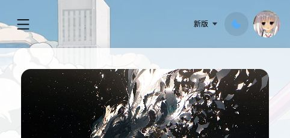

图 21｜**原有验收局部截图**：Kira 手机顶部“新版”入口，无框、文字随日夜配色。新版对应“旧版”加小三角，当前完整画面见下文。来源[双主题记录](../../../.scratch/starry-blog/evidence/dual-theme-20261010/README.md)。

同轮作者指出从旧版切入时先见完整插画、再突然挖空窗口。实现从第一帧使用最终遮罩，深蓝承接窗内，实时天空预绘完成后仅天空层约 0.45s 淡入，人物与前景保持稳定；失败仍可读文章清单。`c92b10b` 根据作者反馈把探索下边界上移，山丘最多约五分之一，覆盖缩放、拖动、键盘、尺寸调整和停靠，不移动真实星位。`cb8ea88` 暂隐藏远方信号，原实现保留。

来源：[首屏窗景](../../../.scratch/starry-blog/evidence/startup-window-20261010/README.md)、[视角边界](../../../.scratch/starry-blog/evidence/camera-bounds-20261010/README.md)、[设计更新](../../design/starry-blog.md)。10-10 确认 Netlify Production branch 为 `master`，仓库中的正式与 Deploy Preview 同用 `npm run netlify`；未得到实际云构建、合并或线上切换成功的证据。

## 15. 10-10 资料归档；10-11 写作模板与说明维护

`9d90d8b` 将早期规格、01–18 工单、V19 冻结、V20 验收、美术与阶段记录归入 `.scratch/starry-blog/archive/`，有效复测脚本归入日期 `evidence/`。作者确认删除了 34 份过期日志和 15 份重复草稿，另保留 07 的不同验收措辞。移动／删除与校验有[清单](../../../.scratch/starry-blog/archive/cleanup-20261010.json)，不能当作完成了所有历史 open 工单。

10-11 的 `585b6f7` 改新文章模板：`hexo new post "我的新文章"` 后带常用字段缺省值和中文作用注释；Hexo 创建时会丢 YAML 注释，于是在根 `new` 事件恢复新 post 的模板注释，不改变已有文章、page 或 draft。封面和关系是**空默认值**，没有自动创作封面，也没有擅自选择文章关系。身份、最初地址、摘要和星位在预览／构建时准备。真实 CLI 的临时新文章验证后删除，当前文章数仍为 10。

`87a0401` 更新根与主题 README、两份操作指南及开发索引，纠正默认主题、双构建、旧版切换、新模板、手机位置、当前文章视觉与工程证据。83 个相对链接、4 个锚点与 12 个 npm 脚本引用核对通过。这是文档维护，不是一次新的页面改版。

实现入口：[post scaffold](../../../scaffolds/post.md)、[注释恢复](../../../scripts/post-scaffold.js)、[日常操作](../../operations/starfield-blog.md)、[当前工程职责](../../../themes/stargazer-starfield/README.md)。

## 16. 新星图与文章检索：已提出、已有图稿，尚未接入

[检索规格](../../../.scratch/starry-search/spec.md)标注 10-10，相关素材与记录提交为 10-11 的 `f23876d`、`0e3c72b`、`44b68c2`、`e235a8c`。两个日期均保留，不推定实际讨论时刻。

已记录的作者方向：拖动显露小星图，点击展开详细图；详细图显示全量文章位置与当前视野，右侧索引默认收起；输入搜索自动展开，清空后保持展开；点击标题直接阅读，不必先定位或二次点击。编号与坐标的分离、动画方式等部分仍是建议。这里属于对 10-08 移除小图、早期暂缓站内搜索的后续更新。

底图从浅冷蓝初稿 v1，修正未预留搜索带的 v2，加边缘装饰的 v3，再改深蓝白线 v4；另有细长透明搜索框与四款配套图标候选。原图、提示词和参考见[素材索引](sources.md#检索图稿)。**没有实现输入、索引展开、检索跳转或立体展开动画，没有替作者选图标，没有发布**。图稿不能放到“已完成博客画面”里。

## 17. 截止本次整理：当前本地的样子与状态

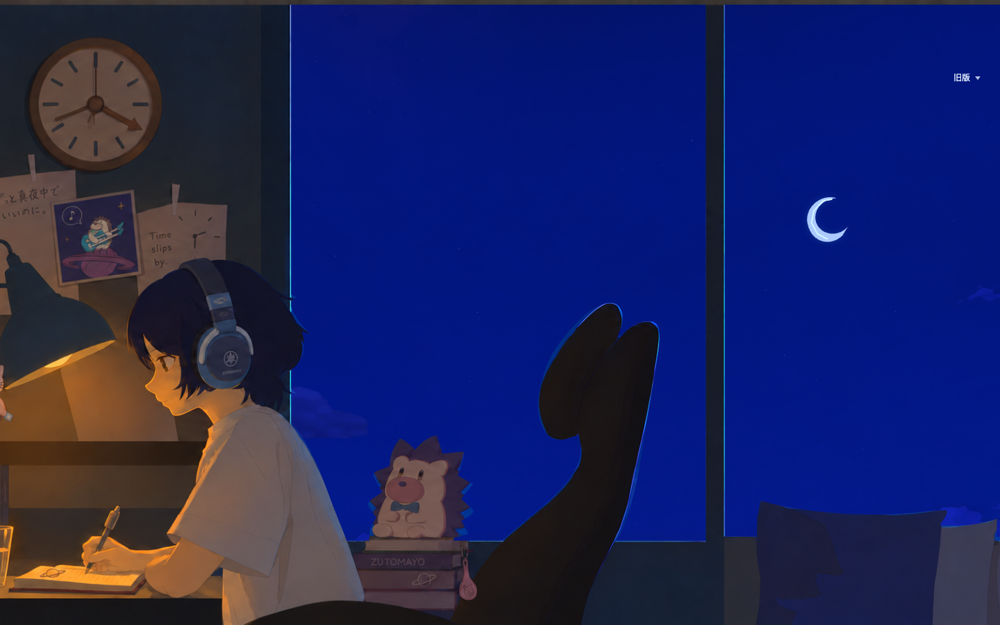

图 22｜**当前本地截图**，1440×900、DPR1。采用海报细化的桌面房间前景，窗内是实时天空，右上有旧版入口。

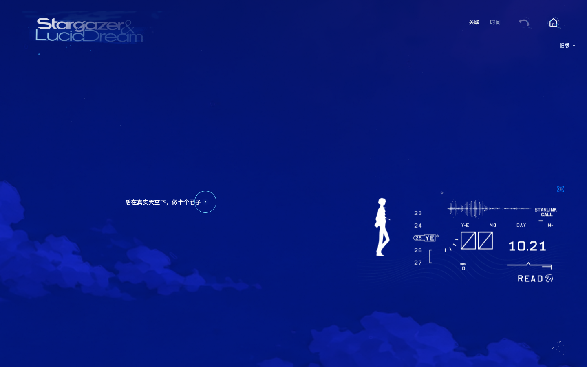

图 23｜**当前本地截图**，同视口。Logo2、宝蓝天空、原素材面板与真实日期，未恢复小星图。选中的是《活在真实天空下，做半个君子》。

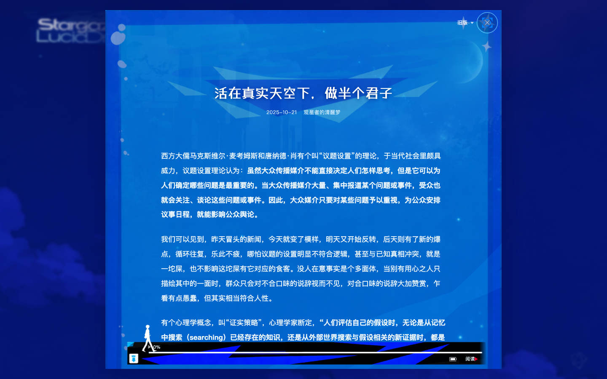

图 24｜**当前本地截图**。蓝色原图文章页，日期与署名在标题下，底部人物和阅读进度，阅读层内保留旧版入口。

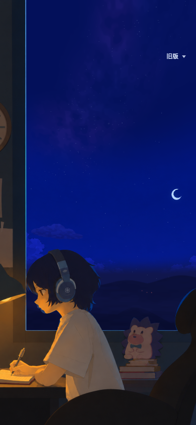

图 25｜**当前本地截图／手机模拟**，390×844、DPR1，独立竖版房间构图。不是实体手机验收。

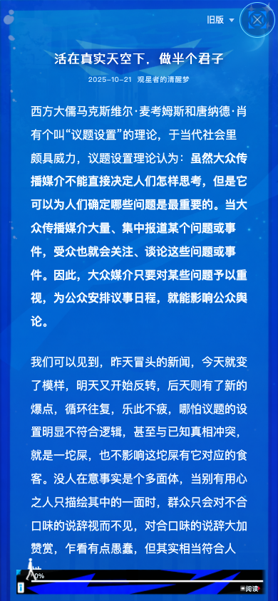

图 26｜**当前本地截图／手机模拟**，同视口。完整图片另见[桌面未选星](images/current-desktop-sky.png)、[手机星空](images/current-mobile-sky.png)。

本次对当前生成页面核对了 `app.js`、`motion.js`、`painted.js`、`room-scene.js`、`dome.js` 与工作区源文件逐字节一致；截图页未记录 pageerror，原型／Kira 21 张复现和正式／当前 9 张采集也均无 pageerror。这只描述采图过程，没有新增性能测量或完整验收结论。

截至 `87a0401`：真实内容 10 篇、两主题本地统一构建、保存星位、旧路径／媒体兼容、静态回退与现有操作已实现；封面／关联由作者选择，未采用的检索设计保持图稿。没有证据证明本轮已切换线上、所有设备达到性能目标、Safari／实体触屏通过或第三方音频正常播放。

## 18. 资料缺口、冲突和恢复限制

| 项目 | 已知／缺失 | 写作时的处理 |
| --- | --- | --- |
| 第一次提出想法 | 有整理后的访谈索引和设计目的；无完整原始会话、首次构思精确日期或更早草图 | 可描述记录中的方向，不能补第一句原话或心理过程 |
| 最初博客／首次上线 | Git 始于 2025-10-19；未找到各次上线时间和当年的线上截图 | Git 日期写作提交日期；图 1 标复现，不标首发 |
| V14–V18 独立版本 | 研究文档齐；独立提交／冻结副本未找到；09-30 保存的是累计代码 | 逐步说明依据文档，缺画面就明确缺；不把 V19/V20 图片改标签充数 |
| `v=` 参数 | 当前原型共用同一套代码；修改 URL 中版本数不会恢复过去 | 只有独立冻结或指定 Git 源码可以作为历史实现 |
| V19 冻结日期 | 目录标 09-14，09-30 入 Git；冻结清单描述当时字节，跨系统可能换行转换 | 分别报告记录／冻结名与 Git 日期，不重写清单迎合环境 |
| 历史试稿分支 | 文档提到 `codex/prototype-starfield`、`dev` 等，现可列出的分支没有这些；`42b9ff7` 对象未找到 | 引用可达正式提交和存档文件，不承诺所有旧分支仍可 checkout |
| V11 两段生图提示词 | 文件中实际为 `undefined`；素材与来源类型仍在 | 不能补造提示词，也不能声称提示词完整 |
| 动效参考原视频 | 有 V14 参考截图，步行提取姿势与页面录像；原十秒参考及原步行录屏未在仓库找到 | 将参考材料和博客画面区分；不宣称附上原片 |
| ZTMY 重绘 | 工具实际1672×941且作者要求回退 | 同时记录试作和回退，不称当前入口或4K升级 |
| 记录日期与 Git 日期 | 注记、配色、检索存在跨午夜或较晚落库；没有精确讨论时间 | 两种日期并列，不猜原因 |
| 历史状态文字 | 09-30整体确认后，个别后续文档仍保留“待整体复核”；10-01计划仍写当时默认Kira | 以有日期的明确决定与后来实现为准，注明旧文字的时间范围 |
| 早期公开模板与工单 | 当前收口为个人站点；历史工单原状态保留 | 不把模板发行、校准工具、全部工单算已交付 |
| 文末关系与自动生成 | 有临时关系验收；当前源文章无作者配置的 `related` 条目 | 不把测试理由或探索邻近线当作者真实内容关系 |
| 被删材料 | 34日志＋15重复草稿物理删除；清单仍在，原已跟踪内容可查旧提交 | 不保证未跟踪日志可从Git恢复；清单只证明曾存在与删除理由 |
| 大型验收产物 | 10-09起多数截图／逐次JSON／录像仅本机保存；部分旧提交有历史产物 | 本资料精选图已另存；其余链接标本地材料，新克隆未必有 |
| 性能与发布 | 有本地数据、模拟触屏、配置与部分失败样本；真机、Safari、云构建、线上深链接和音频成功仍缺 | 保留环境、样本与限制，不换算“所有设备稳定60fps”或“已上线” |
| 工具辅助与作者劳动 | 有明确作者反馈、素材提供、工具生成记录；无逐行工作分工与工时 | 陈述提出、选择、反馈与实际处理；不编造手绘／手写或开发时长 |

原始材料继续从[资料索引](sources.md)查阅；新的个人回忆或原始截图若由作者补充，应另标来源与日期，不倒写成当前已核实的记录。
